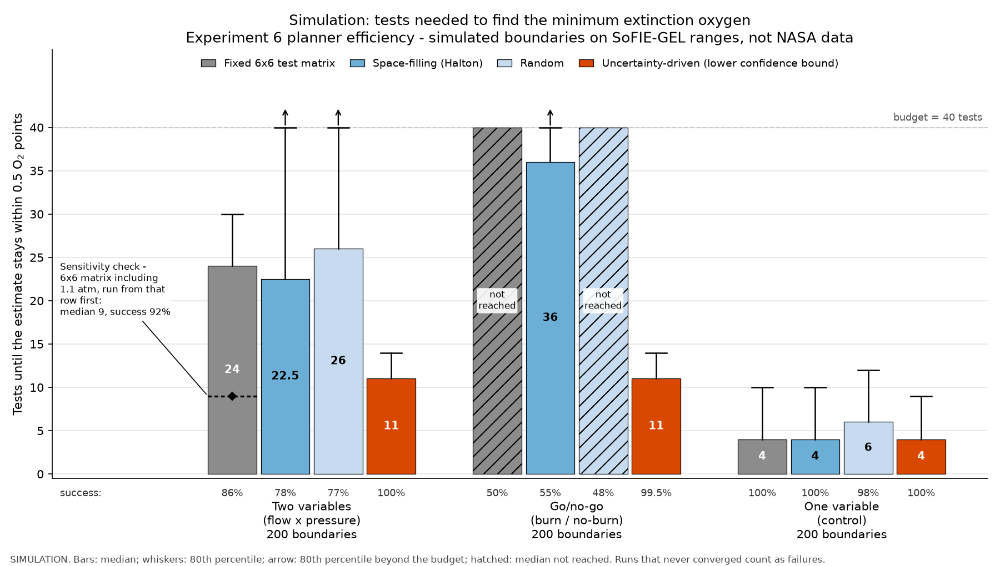

# Experiment 6: Planner efficiency (SIMULATION)

> **SIMULATION.** Every extinction boundary here is simulated. The boundaries are anchored only on the published SoFIE-GEL operating ranges: forced flow 0.2-80 cm/s, oxygen 13-34% and pressure 0.15-1.1 atm. They are not NASA data and are not measurements of any material.

**Headline.** In simulation (200 random two-variable boundaries), choosing each test by uncertainty found the minimum extinction oxygen within 0.5 points in a median of 11 tests (80th percentile 14) versus 24 (80th percentile 30) for the plan's fixed 6x6 test matrix, with 100% vs 86% success.

**Claim (the only one allowed).** Choosing each test by uncertainty needed about half the tests of a fixed matrix run in the plan's order, in simulation (median 11 vs 24 tests, success 100% vs 86%, 200 simulated two-variable boundaries); a matrix that includes 1.1 atm, where the simulated minimum always lies, and runs that row first needed fewer at the median (9) but succeeded less often (92%) and had a longer tail (80th percentile 23.4 vs 14).

**Pass: yes.** The test passes when the uncertainty-driven planner needs fewer tests than the plan's fixed matrix at the median in the two-variable variant, with a success rate at least as high.

**Caveat.** The saving depends on how the fixed matrix is laid out. MOC rises as pressure falls, so the simulated minimum always lies at 1.1 atm. A 6x6 matrix that includes 1.1 atm and runs that row first needed a median of 9 tests (80th percentile 23.4, success 92%). The uncertainty-driven planner, given no hint about where the hazard lies, needed a median of 11 (80th percentile 14, success 100%). The planner's advantage is that it does not need that prior knowledge, not that it beats every matrix at the median. See the fixed-matrix layout table.

## What was compared

The question is how many tests (burns) each test-selection strategy needs before its estimate of the most hazardous condition, the minimum extinction oxygen, settles within 0.5 O2 points of the true value. A run *converges* at the first test count after which the estimate stays within 0.5 points for the rest of the 40-test budget. Runs that never settle count as failures (infinite), so they push up the median and 80th percentile.

- **Fixed matrix:** a 6x6 grid run in a fixed order, as in the plan's prototype. In the two-variable variant it is 6 flows by 6 pressures: flows low to high, with all pressures at each flow, at levels set at 5-95% of each range. Tests 37-40 repeat the first cells. The one-variable control uses 6 flows swept low to high, repeated. The go/no-go variant uses 6 flows by 6 oxygen levels.
- **Space-filling:** the Halton sequence (bases 2 and 3).
- **Random:** uniform draws over the test range.
- **Uncertainty-driven:** the first few Halton points (5, or 4 in the one-variable control). After that, each test goes where the model's lower confidence bound (mean - 2 s.d.) on the extinction oxygen is lowest.

Within a variant every strategy uses the same estimator, so only test selection differs. For limit tests the estimate is the minimum of a Gaussian-process posterior mean over a dense grid. For go/no-go tests it is the posterior mean of the minimum from a Bayesian grid model for burn / no-burn outcomes.

## Results

### Two-variable boundary (log-flow x pressure), main variant: 200 boundaries

| Strategy | Success | Median tests | 80th percentile | Mean tests (converged runs) |
|---|---|---|---|---|
| Fixed 6x6 test matrix (6 flows x 6 pressures) | 86% (172/200) | 24 | 30 | 22.4 |
| Space-filling (Halton) | 78% (155/200) | 22.5 | not reached (>40) | 20.4 |
| Random | 77% (154/200) | 26 | not reached (>40) | 21.5 |
| Uncertainty-driven (lower confidence bound) | 100% (200/200) | 11 | 14 | 11.1 |

Paired by boundary, the uncertainty-driven planner needed fewer tests than the fixed design on 194 of 200 boundaries, the same number on 2 and more on 4.

Ratio of medians (uncertainty-driven / fixed matrix): 0.46, with a 95% paired bootstrap interval of 0.42-0.48 (2000 resamples of boundaries).

### Go/no-go tests (drop-tower style: flow x oxygen, burn / no-burn only): 200 boundaries

| Strategy | Success | Median tests | 80th percentile | Mean tests (converged runs) |
|---|---|---|---|---|
| Fixed 6x6 test matrix (6 flows x 6 oxygen levels) | 50% (100/200) | not reached (>40) | not reached (>40) | 24.7 |
| Space-filling (Halton) | 55% (110/200) | 36 | not reached (>40) | 23.9 |
| Random | 48% (96/200) | not reached (>40) | not reached (>40) | 25.4 |
| Uncertainty-driven (lower confidence bound) | 99.5% (199/200) | 11 | 14 | 12.0 |

Paired by boundary, the uncertainty-driven planner needed fewer tests than the fixed design on 192 of 200 boundaries, the same number on 2 and more on 6.

### One-variable control (flow only, 1.1 atm slice): 200 boundaries

| Strategy | Success | Median tests | 80th percentile | Mean tests (converged runs) |
|---|---|---|---|---|
| Fixed sweep (6 flows, repeated low to high) | 100% (200/200) | 4 | 10 | 7.0 |
| Space-filling (Halton) | 100% (200/200) | 4 | 10 | 7.6 |
| Random | 98% (197/200) | 6 | 12 | 9.1 |
| Uncertainty-driven (lower confidence bound) | 100% (200/200) | 4 | 9 | 6.1 |

Paired by boundary, the uncertainty-driven planner needed fewer tests than the fixed design on 66 of 200 boundaries, the same number on 70 and more on 64.

### Fixed-matrix layout (sensitivity check)

A fixed matrix's run order and levels are arbitrary choices, and here they matter. MOC rises as pressure falls, so the simulated minimum always lies at the highest pressure, 1.1 atm. The plan's matrix levels stop at 1.05 atm. The same boundaries and noise were rerun with other layouts.

**Two-variable boundary**

| Fixed-matrix design | Success | Median tests | 80th percentile |
|---|---|---|---|
| plan order (flows low to high, every pressure level at each flow); levels at 5-95% of each range **(main)** | 86% | 24 | 30 |
| highest-pressure row first (flows low to high in each row); levels at 5-95% of each range | 90% | 10 | 39 |
| lowest-pressure row first (flows low to high in each row); levels at 5-95% of each range | 81% | 33 | 36.2 |
| one fixed shuffled order (seed 6); levels at 5-95% of each range | 78% | 18 | not reached (>40) |
| plan order (flows low to high, every pressure level at each flow); levels span the full ranges, ends included | 88% | 23 | 30 |
| highest-pressure row first (flows low to high in each row); levels span the full ranges, ends included | 92% | 9 | 23.4 |
| *Uncertainty-driven planner, for reference* | 100% | 11 | 14 |

**Go/no-go tests**

| Fixed-matrix design | Success | Median tests | 80th percentile |
|---|---|---|---|
| plan order (flows low to high, every oxygen level at each flow); levels at 5-95% of each range **(main)** | 50% | not reached (>40) | not reached (>40) |
| plan order (flows low to high, every oxygen level at each flow); levels span the full ranges, ends included | 21% | not reached (>40) | not reached (>40) |
| *Uncertainty-driven planner, for reference* | 99.5% | 11 | 14 |

### One line per variant

- Two variables (200 boundaries): uncertainty-driven median 11 tests, success 100%; fixed 24, 86%; space-filling 22.5, 78%; random 26, 77%.
- Go/no-go (200 boundaries): uncertainty-driven median 11 tests, success 99.5%; fixed not reached (>40), 50%; space-filling 36, 55%; random not reached (>40), 48%.
- One-variable control (200 boundaries): uncertainty-driven median 4 tests, success 100%; fixed 4, 100%; space-filling 4, 100%; random 6, 98%.



## Method

**Simulated boundary.** For each seed, the MOC (the minimum oxygen that sustains burning) is an asymmetric U in log-flow. The quench side, at low flow, is steep, with curvature 20-60 per unit of normalized log-flow squared. The blowoff side, at high flow, is gentler (8-30). At 1.1 atm the minimum sits at a flow of 1.2-13 cm/s. Its value, the minimum extinction oxygen, is drawn uniformly in [13.0, 14.0)%. In the two-variable variant, MOC rises as pressure falls, by +3 to +8 points at the optimum flow at 0.15 atm. Two interaction terms couple flow and pressure. The flow at the minimum shifts with pressure, and the U narrows by a factor of 1.5-2.5 at 0.15 atm. The shift is capped so that MOC rises as pressure falls at every flow, which keeps the boundaries nested. Values are clipped to 13-34%. The one-variable and go/no-go boundaries are the 1.1 atm slices of the same random boundaries.

**Tests.** A limit test returns the MOC at the chosen condition plus Gaussian noise (s.d. 0.5 points). A go/no-go test at a chosen flow and oxygen returns burn when the oxygen exceeds the boundary plus Gaussian noise (s.d. 0.5 points), and no-burn otherwise. On a given boundary, every strategy sees the same noise sequence (common random numbers).

**Estimators (shared by all strategies).** The limit-test variants use Gaussian-process regression. It has a Matern-5/2 kernel with one length scale per input, a constant mean, standardized outputs and the known noise s.d. of 0.5. The signal variance and length scales are refitted by maximum marginal likelihood at the first fit and every 5th test, and held fixed in between for speed. The estimate after each test is the minimum of the posterior mean over a dense grid: 41x41 for two variables, 201 points for one. The first estimate comes after test 5 for two variables and after test 4 for one. The go/no-go variant uses a Bayesian grid posterior over the parameters of an asymmetric U-shaped boundary: the minimum oxygen, the flow at the minimum and two curvatures. It has a probit likelihood and known noise. Its prior is uniform over a minimum oxygen of 11-22%, the whole flow range and curvatures of 5-120. The estimate is the posterior mean of the minimum extinction oxygen, from test 5 on.

## Settings

- Label: SIMULATION. Budget 40 tests per run; tolerance 0.5 O2 points; noise s.d. 0.5 points; lower-confidence-bound kappa = 2.0.
- Boundaries: 200 two-variable, 200 go/no-go and 200 one-variable. Boundary i uses seed 600000 + i in every variant. Runs: 2400 main and 1200 sensitivity.
- Seeds: noise draws use numpy default_rng([2026, variant code, i]). The random strategy uses default_rng([2026, variant code, i, strategy code]). The shuffled matrix order uses seed 6, and the bootstrap uses seed [2026, 77].
- Fixed-matrix levels (main) are set at 5%, 23%, 41%, 59%, 77% and 95% of each normalized axis: flows 0.27, 0.79, 2.33, 6.86, 20.17, 59.29 cm/s; pressures 0.198, 0.368, 0.539, 0.711, 0.882, 1.052 atm; oxygen 14.05, 17.83, 21.61, 25.39, 29.17, 32.95%.
- Runtime: 1119 s on one shared CPU core (two-variable 299 s, one-variable 122 s, go/no-go 344 s, fixed-matrix sensitivity 353 s).
- Run sizing: Counts were sized from a 10-boundary pilot of every variant plus the sensitivity runs. It took 52.5 s wall time on the shared single core (21.5 s CPU), which projects about 18 min for 200 boundaries per variant, under the 40-minute limit.
- `results.json` records every setting under `settings`.

## Limitations

- **Simulated boundaries, not NASA data.** The boundaries are anchored only on the published SoFIE-GEL ranges. The U shape, curvatures, pressure rise, interaction terms and noise level are assumptions, not fits to measurements.
- MOC rises as pressure falls, so the simulated minimum always lies at the highest pressure. A fixed matrix's layout therefore matters (see the sensitivity check). A team that already knows where the hazard lies can order a matrix to find it early. The planner was given no such hint.
- The go/no-go model has the same functional form as the simulated boundary. That is a best case for model-based estimation, although all four strategies share it. Real boundaries will not match any model exactly.
- The tests are idealized: one limit test returns one noisy MOC value. There is no cost for changing conditions, no failed or aborted tests and no facility constraint such as drop-tower test time.
- Gaussian-process hyperparameters are refitted only every 5th test, as stated above. The lower-confidence-bound setting (kappa = 2) and the start designs were fixed in advance, not tuned.
- These numbers describe this simulation only. They can support planning decisions, not safety limits.

## How to rerun

From the package root (`nextburn_experiments/`):

```
python experiments/exp6_planner_sim.py            # full run: results/exp6/ and dashboard_data/exp6_sim.json
python experiments/exp6_planner_sim.py --quick    # ~10-boundary smoke run: results/exp6/quick/ only
python experiments/exp6_planner_sim.py --boundaries 300 --small-boundaries 150
```

Seeds are fixed, so a rerun with the same counts reproduces these numbers. `--no-sensitivity` skips the fixed-matrix layout check.

## Files

- `results/exp6/results.json`: settings, strategy tables, headline, claim and pass.
- `results/exp6/runs.csv`: one row per boundary, variant and strategy. `tests_to_converge` is blank when the run never converged.
- `results/exp6/runs_fixed_matrix_sensitivity.csv`: fixed-matrix runs with the other layouts.
- `results/exp6/chart.png`: the slide chart.
- `dashboard_data/exp6_sim.json`: a compact copy for the dashboard (full runs only).
